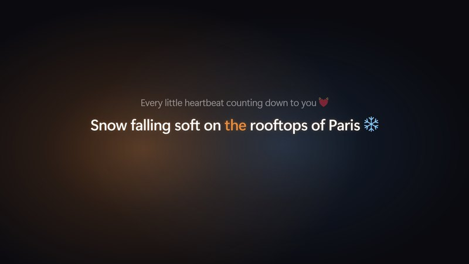
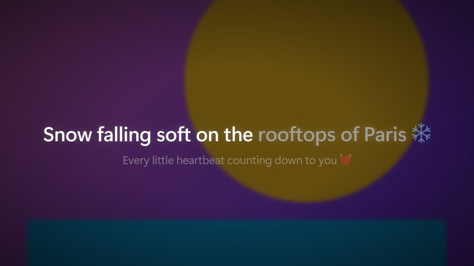
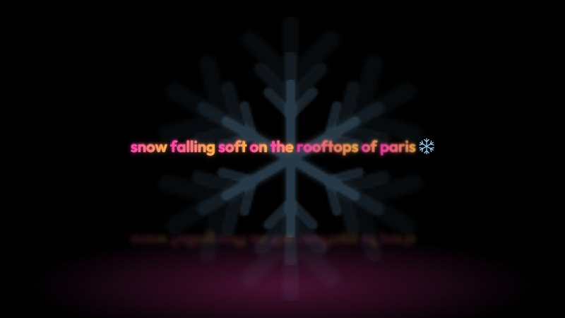
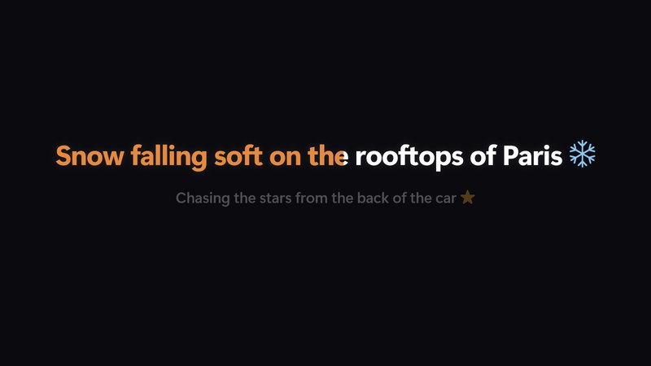
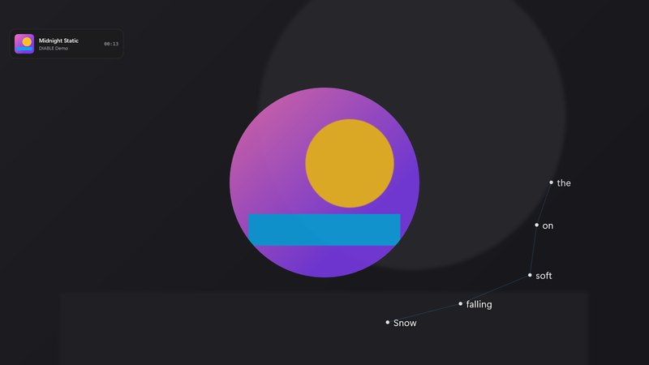

# DIABLE

**Your desktop, lit up by your music.**

A glow around the edges of your screen that moves to the beat and takes its colours from the album cover.
A Dynamic Island at the top of the screen for your music and everything else.
Live, word-by-word lyrics in 15 styles.

Windows 10 (1903 or newer) and Windows 11 · 64-bit · free

---

## Install in a minute

1. Open the **[latest release](https://github.com/ayaanoski/diable-by-vinsmoke/releases/latest)** and download `DIABLE-Setup-x.y.z.exe`.
2. Run it. If Windows shows *"Windows protected your PC"*, click **More info → Run anyway**.
3. Play a song in Spotify, YouTube, Apple Music or any other player. That's it.

A short welcome tour shows you around on first launch. DIABLE lives in the **tray** (the little icons next to the clock): click its icon for settings.
It can **launch at startup** and **updates itself**: new versions install with one click, and "What's new" tells you what changed.

No account, no API keys, no sign-in. It works with any app that shows up in Windows' media controls.

---

## ✨ The edge glow

A soft light around the rim of your screen, like an Ambilight for your PC.

- **Album colours.** The glow takes the main colours of the song's cover, and changes as soon as the song does.
- **Moves to the music.** It listens to what your PC is playing (not your microphone) and pulses on the beat.
- **Animations:** Music Sync, Trails, Breathe, Idle, a still glow, or **Screen colours**, where the rim glows in the colours at the edges of whatever is on screen.
- **Your colours, if you prefer.** Pick two colours on a colour wheel, how much of each, and how bright.
- **Notification flashes.** Each app can flash its own colour when a notification comes in (or not at all).
- **Timers you can see.** A running timer drains around the screen and turns red in its last minute. The breathing exercise makes the whole rim breathe.
- **Smart lights.** Got **WLED**, **Govee** or **Philips Hue** lights? Connect them and your room follows the glow and the beat.
- **Every screen.** One monitor or all of them. Clicks go straight through the glow, and it never steals focus from your game or app.

---

## 🏝️ The Dynamic Island

A small pill at the top of your screen. **Rest the pointer on it** to open it.

**Music**
- Play, pause, skip, the album art and a seek bar for whatever is playing.
- **"What's this song?"** listens for a few seconds and asks Shazam.
- **Played today** lists every song you played today.
- **Discord status.** Your Discord profile can show the song and the line being sung right now.

**It pops up on its own for**
- Volume and brightness changes
- Notifications, as they arrive
- Battery, charging and low battery
- Downloads finishing
- Bluetooth devices connecting, Wi-Fi changes
- Anything you copy
- Your next meeting (from your Google or Outlook calendar link)
- A small dot while your camera or microphone is in use, so you always know

**Tools in the island**
- 🌤️ **Weather** for where you are
- ⏱️ **Timer**, 🍅 **Pomodoro** and a 🫁 **two-minute breathing exercise**
- 📋 **Clipboard history**
- 📂 **File shelf.** Drop any file or folder on the island to keep it there, even after a restart. Drag it out into a folder, an email or a chat when you need it.
- 🔊 **Sound panel.** Switch between speakers and headphones, set each app's volume and your monitors' brightness, and set a sleep timer or a volume limit for the night.
- ⚡ **Quick actions.** Scroll on the island to lock the PC, mute the mic, switch dark mode or turn on do not disturb.

Press **Right Alt + L** to hide or show the island (you can change the shortcut).

---

## 🎤 Lyrics

Words light up **in time with the song**, word by word. Open lyrics from the island's right-click menu, the tray icon or settings. With a second monitor, lyrics can open full screen there while you work on the other.

Lyrics take their colours from the album cover too, so every song looks different.

### 15 styles

| | |
|:-:|:-:|
|  **Aura**: a big glowing line over a soft aura |  **Cover**: the album art fills the screen |
|  **Neon**: glowing neon tubes |  **iMessage**: each line typed into a chat bubble |
|  **Maps**: lines as a Maps card; places in the song fly in on a map |  **Codestyle**: the song as a code file |
|  **Kinetic Space**: one word at a time, big and bold |  **Fisheye**: the lyric sheet through a lens |
|  **Karaoke**: fills as you sing, and can score you |  **Branches**: the song grows as a tree |
|  **Constellation**: sung words become a star map |  **Orbit**: words orbit the cover as stars |

Plus **Cinema** (big film subtitles), **Kinetic Stack** and **Echo Stack**.

### What else lyrics can do

- 🌍 **Translate** the lyrics into your language, line by line.
- 🎙️ **Sing along.** In Karaoke, turn on "Sing along" and DIABLE scores your timing. Your voice is only listened to on your PC: nothing is recorded or sent.
- 🎨 **Mood colours.** The highlight warms up in a big chorus and cools down in a quiet verse.
- ❤️ **Favourites.** Press **F** (or the heart) to save the line being sung. One of your favourites becomes the island's *lyric of the day*.
- 🖼️ **Lyric cards.** Turn any line into a picture to post, or make it your wallpaper.
- 🔍 **Search.** **Ctrl + F** finds a line and jumps the song right to it.
- ⏩ **Fix the timing.** Lyrics a little early or late? Press **[** or **]** to nudge them.
- 🖥️ **Anywhere on screen.** Lyrics on your desktop behind your windows, in a small floating pill under the island, or as a screensaver.
- 🔤 **Make them yours.** Fonts, text size and your own colours, all in the lyrics menu.

---

## 🔒 Privacy

- No account and no tracking.
- The glow listens to your PC's **sound output**, never your microphone.
- The microphone is only used by Karaoke's "Sing along" while you have it on, and never leaves your PC.
- Lyrics come from [LRCLIB](https://lrclib.net), a free, open lyrics library. Only the song's title and artist are sent.
- Weather sends only your rough location (about 1 km). Song recognition sends an audio fingerprint, not the audio.

---

## ❓ Questions

**Which music apps work?** Anything that shows up in Windows' media controls (the box that appears when you press a volume key): Spotify, YouTube and other sites in Chrome or Edge, Apple Music, Windows Media Player, VLC and more.

**No lyrics for a song?** Not every song has synced lyrics in the library yet, especially very new or rare ones.

**Will it slow down my games?** The glow and island are light, and the glow never takes focus or blocks clicks. You can switch the glow off from the tray menu and hide the island with Right Alt + L.

**How do I uninstall?** Windows Settings → Apps → DIABLE → Uninstall.

---

Made by **Vinsmoke** · Found a bug or have an idea? [Open an issue](https://github.com/ayaanoski/diable-by-vinsmoke/issues)

