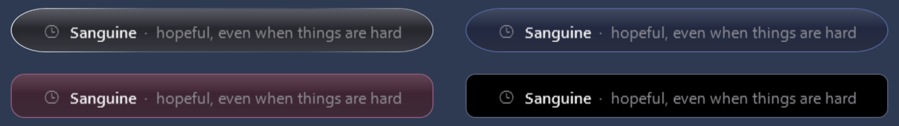
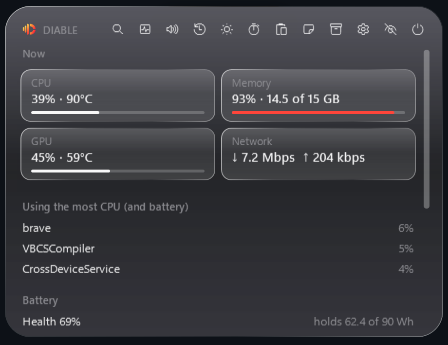
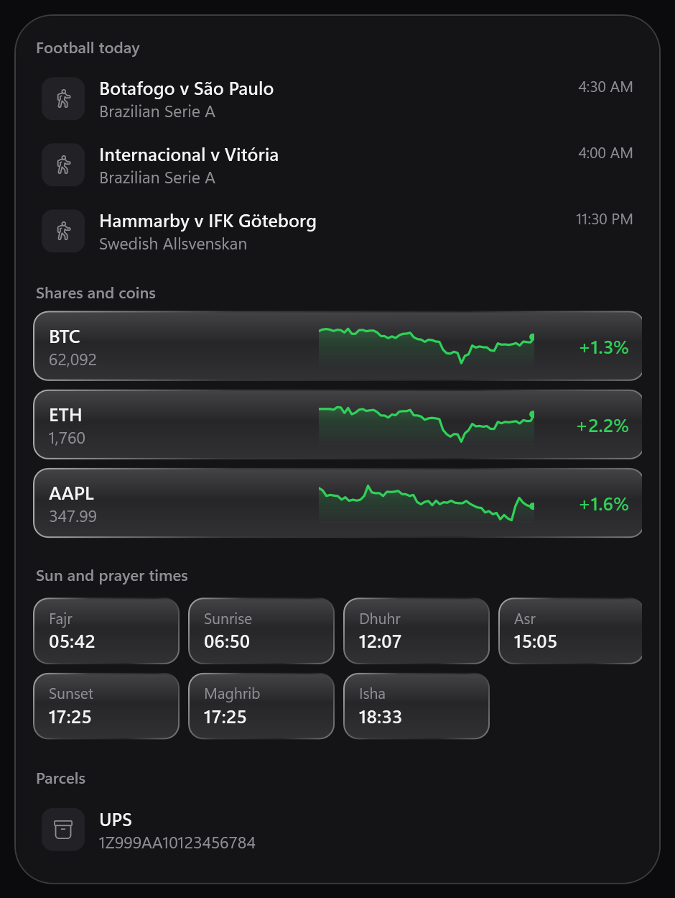
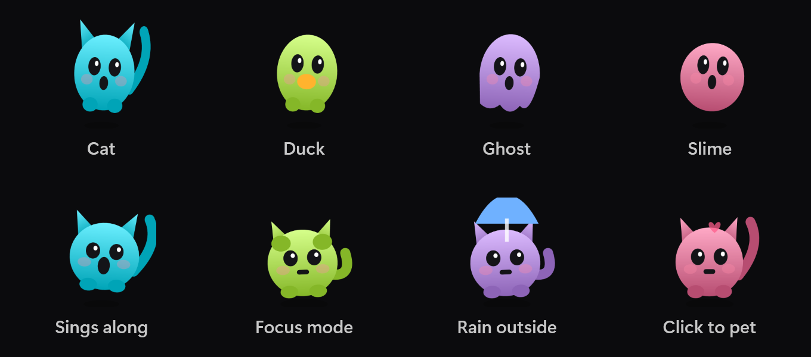
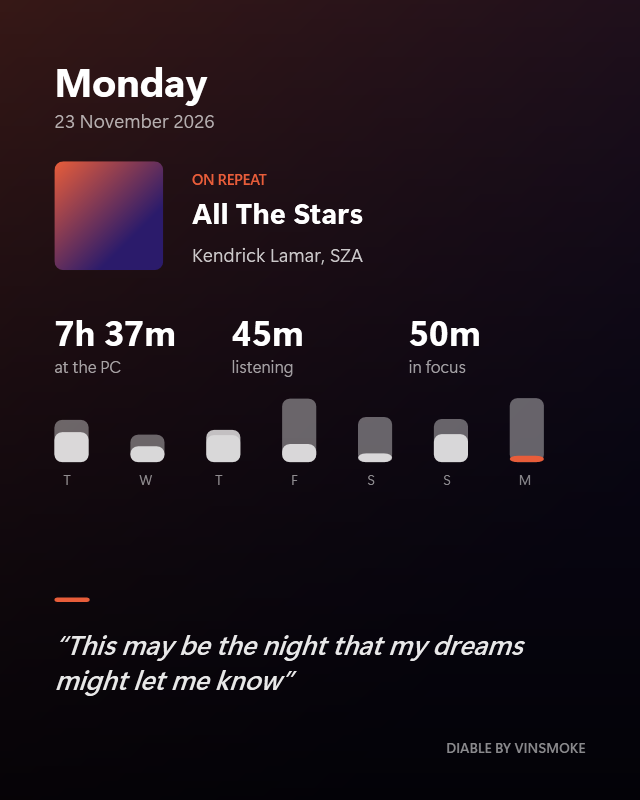
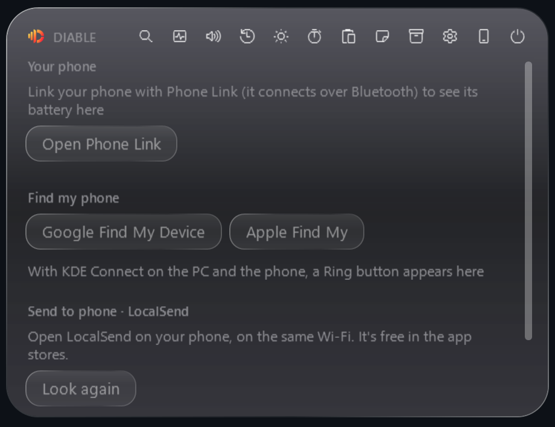
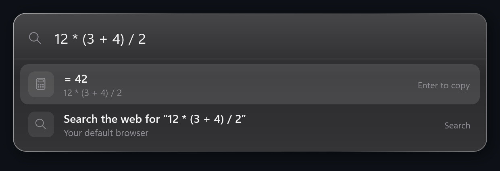
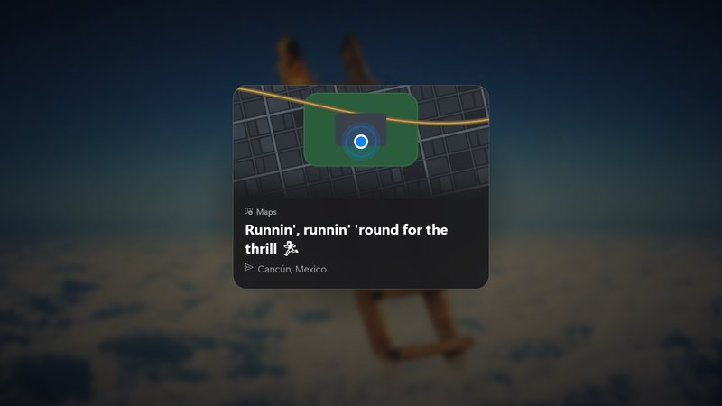
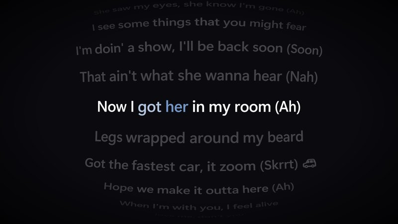
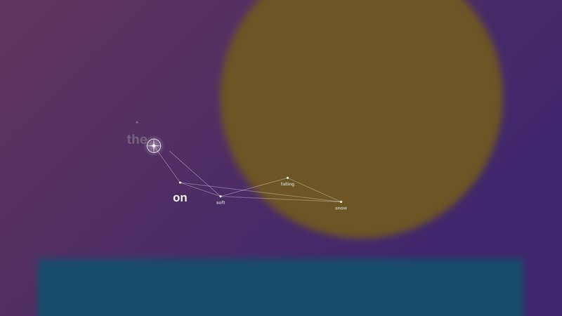

<div align="center">


# DIABLE

Music lighting, a Dynamic Island and live lyrics for Windows.

[](https://github.com/ayaanoski/diable-by-vinsmoke/releases/latest)

<sub>Windows 10 (1903+) and 11 · 64-bit · free · no account</sub>

<br>


</div>

<br>

DIABLE sits in your tray and does six things:

| | |
|---|---|
| **Edge glow** | A soft light around the edge of your screen, in the colours of the album cover, split across the edges by what the song is doing. |
| **Dynamic Island** | A pill at the top of the screen with your music, notifications and a set of small tools. |
| **Lyrics** | Words that light up as they're sung, in 15 styles, in a window, full screen, on your desktop or in a tiny pill. |
| **Your phone** | Its battery, a way to find it, files sent to it over Wi-Fi, and QR codes for anything you copy — or for a photo, to open on the phone. |
| **Your PC at a glance** | CPU, memory, GPU, temperatures and network on the island, a badge on every window when you hold Right Alt, and a heads-up for calls, a full drive, updates and print jobs. |
| **Live info** | Today's scores, the prices you follow with their charts, sunrise, sunset and prayer times, parcels and flights. |
| **Clean room** | One switch, or automatic with Zoom and OBS, that keeps your clipboard, notes and notifications off a shared screen. |
| **Your shortcuts** | A key of your own for any feature, and a terminal command for scripts and builds. |

It works with anything that shows up in Windows' media controls: Spotify, YouTube in Chrome or Edge, Apple Music, VLC and the rest.

## Install

1. Download `DIABLE-Setup-x.y.z.exe` from the [latest release](https://github.com/ayaanoski/diable-by-vinsmoke/releases/latest).
2. Run it. Windows may say *"Windows protected your PC"*: click **More info**, then **Run anyway**.
3. Play a song.

A one-minute tour runs on first launch. Settings open from the DIABLE icon in the tray. Updates install themselves with one click, and you'll see what changed.

<br>

## The edge glow

The glow takes its colours from the cover of whatever is playing and changes the moment the song does. It listens to your PC's sound output, so it keeps time with the music without touching your microphone.

- **Stem lighting:** the glow splits the song across the edges instead of pulsing as one. The lows hold the bottom edge, voices and guitars the sides, hi-hats and cymbals the top, and the sides lean whichever way the sound is panned, so a riff sweeping right sends the light with it.
- **Animations:** Music Sync, Trails, Breathe, Idle, a still glow, or Screen colours, which follows the edges of whatever is on screen (Ambilight for your monitor).
- **Your own colours** instead of the album's, from a colour wheel.
- **Notification flashes** in each app's colour: green for WhatsApp, blurple for Discord. Each app can be changed or muted.
- **Typing light.** Every keystroke sends a ripple of light out along the bottom edge, and the wheel sends one out from under your pointer; the faster you work, the higher the glow rests between them. Only the timing of a key is read, never which key, and it works with the rest of the glow switched off. Turn it off with **Typing light** on the tray panel.
- **Timers on the rim.** A running timer drains around the screen and turns red in its last minute.
- **Spotlight in focus mode.** Everything dims except the window you're working in, with a rim in the album's colour that follows you from window to window.
- **Tint Windows to the album.** Windows' own accent colour — title bars, Start and the taskbar — follows the album art, and the palette is written to `diable-theme.json` for Windows Terminal or VS Code to watch. Off until you ask for it; your colour and Windows' own settings are saved and put back when you switch it off or quit.
- **Room lights.** WLED, Govee and Philips Hue lights can follow the glow and the beat.

Clicks go straight through the glow, it never steals focus, and it steps aside for full-screen games.

<br>

## The Dynamic Island

Rest the pointer on the island to open it. It also opens by itself when something happens: a song changes, a notification arrives, the volume or brightness moves, your battery runs low, a download finishes, headphones connect, you copy something, or Caps Lock or Num Lock changes. A small dot appears while your camera or microphone is in use.

The buttons along the top of the open island:

| Button | What it opens |
|---|---|
| Search | The command bar (below) |
| System | CPU, memory, GPU, temperatures, network, battery health, the apps using the most power, free space, a speed test |
| Sound | Switch speakers and headphones, per-app volume, monitor brightness, a sleep timer, a volume limit |
| Live | The weather, scores, share and coin prices, sunrise, sunset and prayer times, parcels, flights |
| Timer | 5, 10, 15 minutes, a Pomodoro, a stopwatch, two minutes of guided breathing |
| Notes | Your notes, reminders, countdowns and snippets |
| ⋯ | Played today, the clipboard, the file shelf, your phone, settings and quit |

Six buttons and a ⋯, so the row stays readable. Everything behind ⋯ is one tap away — and anything in DIABLE can have a keyboard shortcut of its own instead.

### Knock for it

Knock twice on your laptop, anywhere on the case, and the island comes out to meet you. It reads the tilt sensor most laptops already carry, so there is nothing to set up and your microphone is never touched. Typing, a single knock and a drum roll are all ignored: it wants two taps about a quarter of a second apart. On a desktop, or a laptop without that sensor, nothing happens.

### Drag a file to it

Carry a file towards the island and it notices from across the screen: the pill's own glass twists into a slow vortex that bends your desktop, with a lit rim in the album's colour, and smooths back into glass once you let go. The island leans your way and opens wider as you get closer. Drop it and the file is parked on the shelf, ready to drag back out anywhere.

### Make it yours

Settings › Island changes the island's colour (Liquid glass, Midnight, Graphite, Rose, Pure black, or the colour of the album playing) and its shape (pill, rounded or square).



When the island is resting it shows the time, date and weather, and every so often a **word of the day** or a **proverb**, your pick. Birthdays on your calendar get a tile in the morning and a burst of confetti on the glow.

The history button opens with **your week**: hours at the PC, hours listening and minutes in focus mode, with a bar for each day. It's counted on your PC and never leaves it.

### Quick actions

Scroll on the island for quick actions:


**Focus mode** runs a 25-minute session: the glow slows to a calm breath and notifications skip the pop-up and wait in the island until you're done. **Pick colour** puts a magnifier by your pointer; click anywhere to copy that colour as `#RRGGBB`. **Record GIF** records the screen you're on, up to 30 seconds, into Videos › DIABLE.

**Keep awake** stops the screen and the PC from sleeping until you switch it off. **Night light** opens Windows' night light (Windows doesn't let apps flip it directly). **Game HUD** shows CPU, GPU, temperatures and RAM in a corner while a game is full screen. **Speed test** checks your ping, download and upload in about 15 seconds.

<br>

## Your PC at a glance

The chart button on the island opens a live view of your PC. It only measures while it's open.



- **CPU, memory, GPU and network**, with temperatures where the PC reports them. On laptops with two graphics chips it shows whichever is busier.
- **Battery health**: how much of its original capacity your battery still holds.
- **The apps using the most CPU**, which are usually the ones draining your battery.
- **Free space** on your system drive, with Windows' Disk Cleanup one click away.
- **Internet speed**: ping, download and upload.

### Hold to peek

Hold **Right Alt by itself** for half a second. Every window on screen gets a glass badge in its top corner with the app's name, its share of the processor and the memory it is holding, and whatever is on your clipboard — with any running timer — floats by the pointer. Let go and it all vanishes at once.

Nothing on that overlay is clickable, so it never gets in the way of what you were doing, and it stays away entirely while clean room is on. Right Alt with any other key is still your shortcut, and AltGr still types what it always did.

The island also lets you know when:

| When | You get |
|---|---|
| You join a call in Zoom, Teams, Discord, Slack, WhatsApp or a browser (Meet) | A call timer in the island, and a mute button when you click it |
| C: is nearly full | A warning with **Clean up** |
| Windows Update needs a restart | **Restart tonight**: it restarts after 3 am, once the PC has been idle for 20 minutes, and never closes an app with unsaved work |
| You print something | The document's progress, page by page, and a warning if the printer needs attention |

<br>

## Live info

The globe button on the island keeps the things you check all day in one place. Everything here is free and needs no account, so there is nothing to set up.



- **Scores.** Today's football or cricket, with the score so far or the kick-off time. Switch sports (or turn them off) with the buttons under the list.
- **Shares and coins.** The ones you follow, each with its price, a week of movement as a chart, and the day's change. Add one from the command bar: `watch BTC`, `watch AAPL`.
- **Sunrise, sunset and prayer times** for where you are, using the same location as the weather (rounded to about 1 km).
- **Parcels.** `track 1Z999AA10123456784` in the command bar works out the carrier from the number and keeps it here; clicking the row opens that carrier's own tracking page.
- **Flights.** `flight AIC302` follows a flight by its callsign and shows whether it is in the air, how high and how fast.

The resting island can also show a **news headline** now and then, between the clock and the weather. Turn it on in Settings › Island › News in island.

<br>

## The pet

A small creature can live in the island, drawn by DIABLE itself, so it costs nothing to download and takes the colour of whatever album is playing. Turn it on in Settings › Island › Desktop pet.



It dances to the beat, **mouths the words** of the song as they are sung, watches your pointer, hops when a notification arrives, cheers when a timer finishes, covers its ears during focus mode, puts an umbrella up when it is raining where you are, and dozes off when the music stops. Click it for a fuss.

Switch on **Let the pet roam** and it leaves the island to live along the bottom of your screens: it strolls, sits, takes a proper nap with Zzz over its head, comes over to your pointer, and dances where it stands while music plays. With more than one monitor it walks off the edge of one and onto the next, and now and then sprints across to another screen. Drag it anywhere, even between monitors, click it to pet it, right-click to send it back to the island. It never takes focus, stays out of Alt+Tab, and steps aside for full-screen games.

<br>

## Your day, as a picture

The history button opens your week. **Share your day** turns it into a picture: the song you have had on, your hours at the PC, listening and in focus, the last seven days as bars, and a line you saved from the lyrics. It lands on your clipboard and in Pictures › DIABLE.



<br>

## Your phone

The phone button on the island:



- **Battery.** If your phone is linked with Phone Link, it stays connected over Bluetooth, and most phones report their battery that way.
- **Calls.** Phone Link's call alerts show in the island with a button to answer in Phone Link. They get through even in focus mode.
- **Find my phone.** With [KDE Connect](https://kdeconnect.kde.org) on both the PC and the phone, a **Ring** button rings it at full volume. Otherwise one click opens Google's Find My Device or Apple's Find My, which can ring it too.
- **Send files.** Open [LocalSend](https://localsend.org) on your phone (free, on the same Wi-Fi) and it shows up here. Send any file, or everything on your shelf. The phone asks you to accept, and the island shows the progress. Files go straight over your Wi-Fi.
- **QR codes.** Copied a link? The **QR** button on its tile shows a code to scan with your phone's camera, drawn big enough to catch from across the room.
- **A photo on your phone.** **QR of a photo…** here, or **To phone** on a screenshot tile, shows a code that opens the picture on your phone — any phone, on any network, whether or not it is on your Wi-Fi, with nothing to set up. Cloudflare gives this PC a temporary web address for it (DIABLE fetches Cloudflare's tunnel program, about 55 MB, the first time you agree, and keeps it). It opens on a small glass page with **Save** and **Copy** on it, and the copy that travels is stamped *sent via DIABLE* — the file on your PC is left alone. The island shows **Generating QR…** while the link comes up. The picture is never uploaded to a file host: it is served from your PC, for 2 hours, while DIABLE is open. If you would rather not, it falls back to a link straight to this PC, which needs the phone on the same Wi-Fi and Windows Firewall letting DIABLE in.

<br>

## The command bar

Press **Right Alt + Space** anywhere and start typing.


| Type | You get |
|---|---|
| `spotify`, `downloads`, `vsc` | The app or file, ready to open. Initials work. |
| `github.com` | Opens the site. Anything else searches the web. |
| `12 * (3 + 4) / 2`, `20% of 150`, `sqrt 2` | The answer. Enter copies it. |
| `5 km to mi`, `100 f to c`, `2 gb to mb` | The converted value. |
| `100 usd to inr` | Live exchange rates. |
| `note buy milk` | Saves a note. |
| `remind me in 20 min to stretch` | A reminder in the island, with a glow flash and a snooze button. `at 5pm` and `tomorrow at 9` work too. |
| `countdown Exams 15 Dec` | A countdown. The nearest one shows on the resting island. |
| `snip ;addr = 12 Park Road, City` | A snippet. Type `;addr` in any app and it turns into your address. |
| `clip invoice` | Searches what you've copied. |
| `watch BTC`, `watch AAPL` | Adds a coin or a share to the Live panel. |
| `track 1Z999AA10123456784` | Works out the carrier and keeps the parcel in the Live panel. |
| `flight AIC302` | Follows a flight by its callsign. |
| any word | Finds your notes, reminders, countdowns and the songs you played this week. |



<br>

## Copy and paste, improved

When you copy text, the island offers three buttons:

- **Translate** into your language.
- **Clean up** copies a plain-text version with tidy spacing and straight quotes, and turns ALL-CAPS text back into normal sentences.
- **Pin** keeps it at the top of your clipboard, even after a restart. You can also right-click anything in the clipboard list to pin it.

When you take a screenshot, **Copy text** reads the words in it and copies them, using Windows' own text recognition.

<br>

## Lyrics

Lyrics light up word by word, in time with the song, and take their colours from the album cover. Open them from the tray, the island or settings. With a second monitor they can run full screen there while you work on the first.

Every shot below is the same play of **Travis Scott — HIGHEST IN THE ROOM**, caught at a different second of the track. The blues come out of that cover on their own.

| | |
|:-:|:-:|
| <br>**Aura** | <br>**Neon** |
| <br>**iMessage** | <br>**Maps**: places in the song fly in on a map |
| <br>**Codestyle** | <br>**Kinetic Space** |
| <br>**Fisheye** | <br>**Karaoke**: scores your timing if you sing |
| <br>**Branches** | <br>**Constellation** |

**Notifications** is the quiet one: each line arrives as a banner from your own system — the album art as its icon, "now" beside it — slides in from the right, sits while it is sung and slides out to the left as the next one lands. Two at a time, neutral white on near-black glass, so the colour in the room stays with the edge glow.

Also Cover, Orbit, Cinema, Kinetic Stack and Echo Stack.

The lyrics menu can also:

- translate the lyrics line by line
- shift the highlight warmer in a loud chorus and cooler in a quiet verse
- nudge the timing with `[` and `]` when a song runs early or late
- put lyrics on your desktop behind your windows, in a floating pill, or on as a screensaver
- **Falling words** (Extras): each line that is sung drops out of the island a word at a time, lands on whatever windows you have open, slides off their edges and piles up at the bottom of the screen. Drag a window and the words resting on it come along and scatter. A line that names rain, snow, fire, love or stars brings a few of those down with it. Off until you switch it on
- save a line with `F`, turn it into a picture to share or set as your wallpaper, and search with `Ctrl + F` to jump the song to a line

<br>

## Shortcuts

Every feature can have a keyboard shortcut of its own: the island, the command bar, lyrics, "What's this song?", focus mode, each of the island's panels, the colour picker, the GIF recorder, the microphone, keep awake and the clean room.

| Keys | Does |
|---|---|
| `Right Alt` `Space` | Open the command bar |
| `Right Alt` `L` | Hide or show the island |
| `Right Alt` held | Peek: badges on every window, the clipboard and any timer by the pointer |
| Two knocks on the case | Open the island (laptops with a tilt sensor) |
| `Right Ctrl` `L` | What's this song? |
| `F` | Save the line being sung (lyrics window) |
| `Ctrl` `F` | Search the lyrics |
| `[` `]` | Lyrics earlier or later |

**Settings › Shortcuts** lists them all. Click one, press the keys you want: Esc cancels, Backspace turns it off. Left and right Ctrl, Alt and Shift count as different keys, and if another feature already holds a combination it says which one rather than quietly taking it.

<br>

## Sharing your screen

**Clean room** keeps what is nobody else's business off the screen while you share it: clipboard previews turn to dots, your notes and reminders are held back, notifications stop popping up and wait in the island instead.

It comes on by itself while Zoom, Teams, Discord, Slack, Webex or OBS is running, and there is a quick tile (and a shortcut) for switching it on any time. A sharing app that is still running holds it on, so it is never dropped early by accident.

**Pause music on calls** is a separate switch: while a call app holds your microphone the music pauses, and it starts again when the call ends. It only restarts what DIABLE paused, so hanging up never overrides your own decision to stop the music.

<br>

## From a terminal

Scripts, builds and CI can talk to the island:

```
DIABLE notify "Build" "Tests passed"
DIABLE progress 40 "Deploy" "Uploading"
DIABLE flash #22c55e
DIABLE confetti
```

The installer puts DIABLE on your PATH, so this works in any terminal opened afterwards. The command goes straight to the copy of DIABLE running as you on this PC — nothing is sent over the network, and nothing but these four commands is accepted.

<br>

## What leaves your PC

| Feature | Sends | To |
|---|---|---|
| Lyrics | Song title and artist | [LRCLIB](https://lrclib.net), a free lyrics library |
| Weather | Your location, rounded to about 1 km | Open-Meteo |
| Song recognition | An audio fingerprint, not the audio | Shazam |
| Translation | The text you asked to translate | Google Translate |
| Currency | Nothing about you, just a request for today's rates | open.er-api.com |
| Speed test | Test data, nothing about you | Cloudflare's speed test (speed.cloudflare.com) |
| Scores | Nothing about you, just today's fixtures | TheSportsDB |
| Share and coin prices | The symbols you follow | Yahoo Finance and CoinGecko |
| Sunrise, sunset and prayer times | Your location, rounded to about 1 km | aladhan.com |
| Flights | The callsign you asked about | adsb.lol |
| Parcels | Nothing. The carrier is worked out on your PC and the number only leaves it when you open their page | — |
| News headlines | Nothing about you, just a request for the feed | BBC News (the Times of India in India) |
| Sending to your phone | The files you choose | Your phone, directly over your Wi-Fi |
| A photo by QR | The picture you choose, as it is opened | Through Cloudflare's tunnel, to whoever has the link. Served from your PC, never stored by them |
| Tint Windows to the album | Nothing. The colour is written to your own Windows settings | — |
| Clean room, focus spotlight, stem lighting | Nothing | — |
| Terminal commands | Nothing. They go to DIABLE on this PC, over a pipe only your Windows account can open | — |

Nothing else. No account, no analytics. Your microphone is only used by Karaoke's *Sing along*, while it's on, and never leaves the PC. Text recognition runs on your PC. Snippets watch only the last few characters you type, in memory, and only while you have at least one snippet.

<br>

## Questions

**My player isn't picked up.** DIABLE follows whatever shows in the box that appears when you press a volume key. If your player doesn't show there, it doesn't tell Windows what it's playing.

**A song has no lyrics.** Not every song has synced lyrics in the library yet, especially very new or rare ones.

**Does it slow down games?** The glow and island pause for full-screen games and never take focus.

**Why doesn't the Game HUD show FPS?** Reading another app's frame rate needs a system trace that only works as administrator. The HUD also can't draw over games in exclusive full screen, only borderless or windowed ones.

**My phone doesn't show up for sending.** LocalSend has to be open on the phone, both devices on the same Wi-Fi, and "Require PIN" off in LocalSend's settings. Then press **Look again**.

**The QR of a photo won't open on my phone.** It should work on any network. If it fails, you are most likely on the Wi-Fi fallback — say yes to the Cloudflare link when DIABLE offers it, and check this PC is online.

**A snippet doesn't expand in one app.** Windows doesn't let normal apps type into programs running as administrator.

**Windows didn't change colour.** Tint Windows to the album turns on Windows' two "show accent colour" settings for you. If your colour looks stuck after turning it off, it is restored when DIABLE closes normally — force-quitting it leaves the colour until DIABLE next starts.

**DIABLE isn't a command my terminal knows.** The PATH entry only applies to terminals opened after installing. Open a new one.

**How do I uninstall?** Windows Settings › Apps › DIABLE › Uninstall.

<br>

<div align="center">
<sub>Made by Vinsmoke · <a href="https://github.com/ayaanoski/diable-by-vinsmoke/issues">Report a bug or suggest something</a></sub>
</div>
