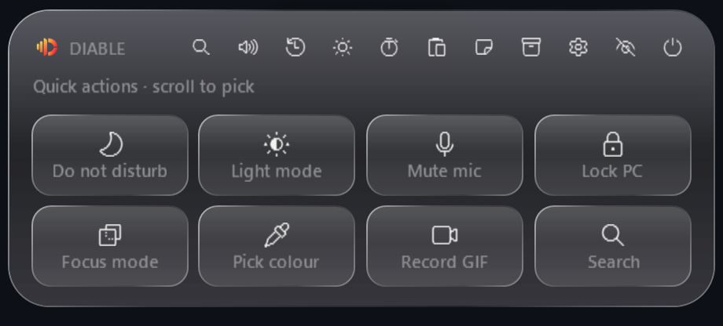
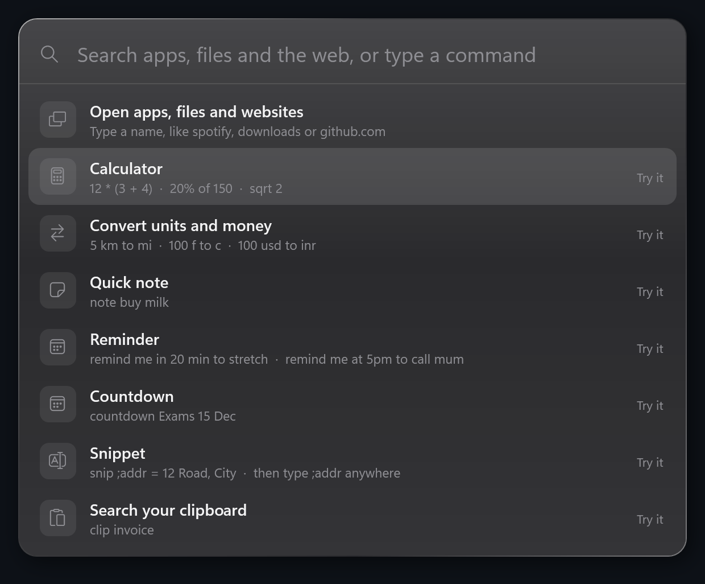
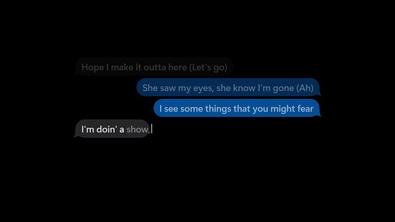
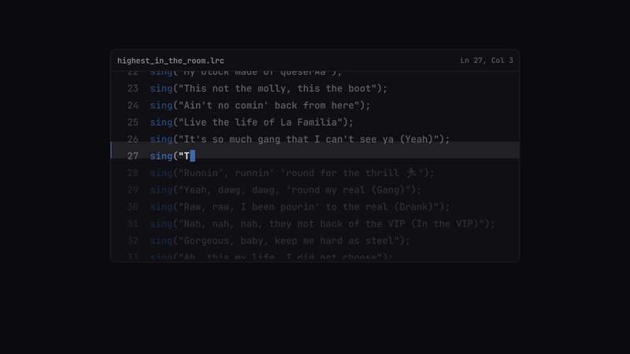
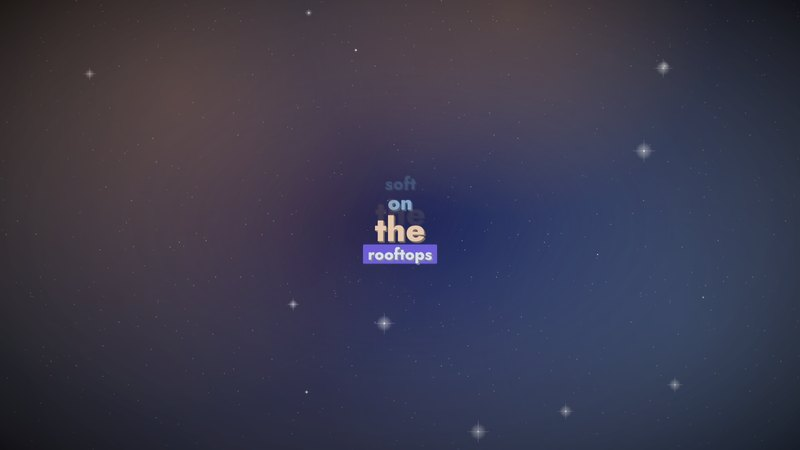
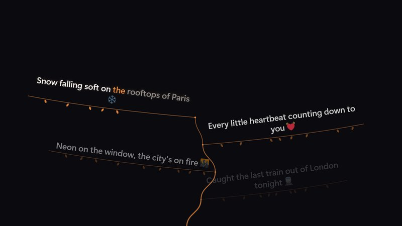

# DIABLE

Music lighting, a Dynamic Island and live lyrics for Windows.

Windows 10 (1903+) and 11 · 64-bit · free · no account

 

 

DIABLE sits in your tray and does three things while you listen:

| | |
|---|---|
| **Edge glow** | A soft light around the edge of your screen, in the colours of the album cover, pulsing to the beat. |
| **Dynamic Island** | A pill at the top of the screen with your music, notifications and a set of small tools. |
| **Lyrics** | Words that light up as they're sung, in 15 styles, in a window, full screen, on your desktop or in a tiny pill. |

It works with anything that shows up in Windows' media controls: Spotify, YouTube in Chrome or Edge, Apple Music, VLC and the rest.

## Install

1. Download `DIABLE-Setup-x.y.z.exe` from the [latest release](https://github.com/ayaanoski/diable-by-vinsmoke/releases/latest).
2. Run it. Windows may say *"Windows protected your PC"*: click **More info**, then **Run anyway**.
3. Play a song.

A one-minute tour runs on first launch. Settings open from the DIABLE icon in the tray. Updates install themselves with one click, and you'll see what changed.

 

## The edge glow

The glow takes its colours from the cover of whatever is playing and changes the moment the song does. It listens to your PC's sound output, so it keeps time with the music without touching your microphone.

- **Animations:** Music Sync, Trails, Breathe, Idle, a still glow, or Screen colours, which follows the edges of whatever is on screen (Ambilight for your monitor).
- **Your own colours** instead of the album's, from a colour wheel.
- **Notification flashes** in each app's colour: green for WhatsApp, blurple for Discord. Each app can be changed or muted.
- **Timers on the rim.** A running timer drains around the screen and turns red in its last minute.
- **Room lights.** WLED, Govee and Philips Hue lights can follow the glow and the beat.

Clicks go straight through the glow, it never steals focus, and it steps aside for full-screen games.

 

## The Dynamic Island

Rest the pointer on the island to open it. It also opens by itself when something happens: a song changes, a notification arrives, the volume or brightness moves, your battery runs low, a download finishes, headphones connect, or you copy something. A small dot appears while your camera or microphone is in use.

The buttons along the top of the open island:

| Button | What it opens |
|---|---|
| Search | The command bar (below) |
| Sound | Switch speakers and headphones, per-app volume, monitor brightness, a sleep timer, a volume limit |
| History | Every song you played today |
| Weather | Conditions where you are |
| Timer | 5, 10, 15 minutes, a Pomodoro, a stopwatch, two minutes of guided breathing |
| Clipboard | Everything you copied recently, with your pinned items on top |
| Notes | Your notes, reminders, countdowns and snippets |
| Shelf | Files you dropped on the island, waiting to be dragged somewhere else |

Scroll on the island for quick actions:

**Focus mode** runs a 25-minute session: the glow slows to a calm breath and notifications skip the pop-up and wait in the island until you're done. **Pick colour** puts a magnifier by your pointer; click anywhere to copy that colour as `#RRGGBB`. **Record GIF** records the screen you're on, up to 30 seconds, into Videos › DIABLE.

 

## The command bar

Press **Right Alt + Space** anywhere and start typing.

| Type | You get |
|---|---|
| `spotify`, `downloads`, `vsc` | The app or file, ready to open. Initials work. |
| `github.com` | Opens the site. Anything else searches the web. |
| `12 * (3 + 4) / 2`, `20% of 150`, `sqrt 2` | The answer. Enter copies it. |
| `5 km to mi`, `100 f to c`, `2 gb to mb` | The converted value. |
| `100 usd to inr` | Live exchange rates. |
| `note buy milk` | Saves a note. |
| `remind me in 20 min to stretch` | A reminder in the island, with a glow flash and a snooze button. `at 5pm` and `tomorrow at 9` work too. |
| `countdown Exams 15 Dec` | A countdown. The nearest one shows on the resting island. |
| `snip ;addr = 12 Park Road, City` | A snippet. Type `;addr` in any app and it turns into your address. |
| `clip invoice` | Searches what you've copied. |

 

## Copy and paste, improved

When you copy text, the island offers three buttons:

- **Translate** into your language.
- **Clean up** copies a plain-text version with tidy spacing and straight quotes, and turns ALL-CAPS text back into normal sentences.
- **Pin** keeps it at the top of your clipboard, even after a restart. You can also right-click anything in the clipboard list to pin it.

When you take a screenshot, **Copy text** reads the words in it and copies them, using Windows' own text recognition.

 

## Lyrics

Lyrics light up word by word, in time with the song, and take their colours from the album cover. Open them from the tray, the island or settings. With a second monitor they can run full screen there while you work on the first.

| | |
|:-:|:-:|
|  **Aura** |  **Neon** |
|  **iMessage** |  **Maps**: places in the song fly in on a map |
|  **Codestyle** |  **Kinetic Space** |
|  **Fisheye** |  **Karaoke**: scores your timing if you sing |
|  **Branches** |  **Constellation** |

Also Cover, Orbit, Cinema, Kinetic Stack and Echo Stack.

The lyrics menu can also:

- translate the lyrics line by line
- shift the highlight warmer in a loud chorus and cooler in a quiet verse
- nudge the timing with `[` and `]` when a song runs early or late
- put lyrics on your desktop behind your windows, in a floating pill, or on as a screensaver
- save a line with `F`, turn it into a picture to share or set as your wallpaper, and search with `Ctrl + F` to jump the song to a line

 

## Shortcuts

| Keys | Does |
|---|---|
| `Right Alt` `Space` | Open the command bar |
| `Right Alt` `L` | Hide or show the island |
| `F` | Save the line being sung (lyrics window) |
| `Ctrl` `F` | Search the lyrics |
| `[` `]` | Lyrics earlier or later |

Both global shortcuts can be changed in Settings › Island.

 

## What leaves your PC

| Feature | Sends | To |
|---|---|---|
| Lyrics | Song title and artist | [LRCLIB](https://lrclib.net), a free lyrics library |
| Weather | Your location, rounded to about 1 km | Open-Meteo |
| Song recognition | An audio fingerprint, not the audio | Shazam |
| Translation | The text you asked to translate | Google Translate |
| Currency | Nothing about you, just a request for today's rates | open.er-api.com |

Nothing else. No account, no analytics. Your microphone is only used by Karaoke's *Sing along*, while it's on, and never leaves the PC. Text recognition runs on your PC. Snippets watch only the last few characters you type, in memory, and only while you have at least one snippet.

 

## Questions

**My player isn't picked up.** DIABLE follows whatever shows in the box that appears when you press a volume key. If your player doesn't show there, it doesn't tell Windows what it's playing.

**A song has no lyrics.** Not every song has synced lyrics in the library yet, especially very new or rare ones.

**Does it slow down games?** The glow and island pause for full-screen games and never take focus.

**A snippet doesn't expand in one app.** Windows doesn't let normal apps type into programs running as administrator.

**How do I uninstall?** Windows Settings › Apps › DIABLE › Uninstall.

 

Made by Vinsmoke · <a href="https://github.com/ayaanoski/diable-by-vinsmoke/issues">Report a bug or suggest something</a>

